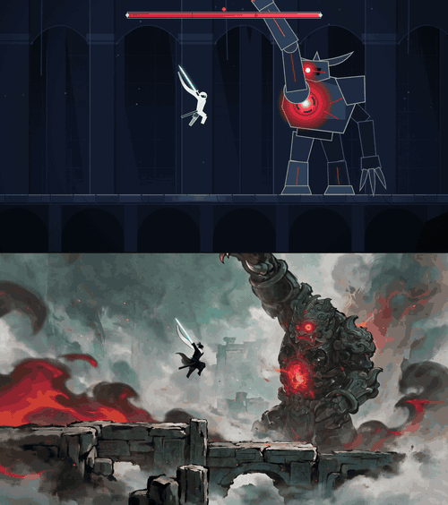

<div align="center">


# Guizang MAGI-2 Skill

**Bidirectional Video-to-Code & Code-to-Video Production Workflows with LibTV + MAGI-2**

English · [简体中文](README.md)

[](LICENSE)
[](https://www.liblib.tv)
[](references/libtv-mcp-antigravity.md)



*Top: Deterministic muted 2D motion greybox written by a coding agent. Bottom: Stylized ink-wash combat trailer rendered by MAGI-2 via LibTV multi-reference.*

</div>

---

## Overview

An agent skill for **Antigravity**, **Claude Code**, and **Codex** that connects ultra-low-cost multimodal video generation (**MAGI-2** + **Seedream 5.5** on **LibTV**) with modern coding models in both directions:

1. **MAGI-2 Prompt Optimization**: 8 empirical rules and 4 copy-ready templates covering anti-compression phrasing, eye light-source isolation, 3-stage skeletal anti-sliding chains, in-sentence Foley welding, and sharp moving CJK text.
2. **LibTV MCP Adapter Fix for Antigravity**: One-command installer (`scripts/setup_libtv_antigravity.py`) resolving `mcp-remote` OAuth stdio bridging, GUI `PATH`/`npx` lookup, 1200s long-render timeouts, optional proxy env forwarding, and safe `wait_interrupted` polling without double-billing.
3. **Bidirectional Co-Creation Workflows**:
   - **Video to Code**: 6-grid storyboard + 10s MAGI-2 motion reference + transparent die-cut PNG stickers (`make_diecut_stickers.py`) → single-stage zero-seam scrollytelling web page + 60fps Canvas pouring fluid + scroll-velocity variable-BPM WebAudio synth.
   - **Code to Video**: Deterministic muted 25fps Canvas/Three.js motion greybox (`prep_code_previs.py`) + 3–4 keyframe relay images → frame-accurate stylized 2D/3D trailers in LibTV `reference` mode.

---

## Installation

### Antigravity
```bash
git clone https://github.com/op7418/guizang-magi2-skill ~/.gemini/antigravity/skills/guizang-magi2-skill
python3 ~/.gemini/antigravity/skills/guizang-magi2-skill/scripts/setup_libtv_antigravity.py
```

### Claude Code
```bash
git clone https://github.com/op7418/guizang-magi2-skill ~/.claude/skills/guizang-magi2-skill
claude mcp add --transport http libtv https://mcp.liblib.tv/mcp
```

### Codex
```bash
git clone https://github.com/op7418/guizang-magi2-skill ~/.codex/skills/guizang-magi2-skill
codex mcp add libtv --url https://mcp.liblib.tv/mcp
```

---

## Repository Layout

| Path | Description |
|---|---|
| [`SKILL.md`](SKILL.md) | Main skill instructions, guardrails, and workflow checkpoints |
| [`references/magi2-prompt-guide.md`](references/magi2-prompt-guide.md) | 8 iron rules & 4 production templates (A–D) for MAGI-2 |
| [`references/libtv-mcp-antigravity.md`](references/libtv-mcp-antigravity.md) | Antigravity MCP adapter setup & runtime troubleshooting |
| [`references/workflows.md`](references/workflows.md) | Engineering blueprints for Video-to-Code and Code-to-Video |
| [`scripts/setup_libtv_antigravity.py`](scripts/setup_libtv_antigravity.py) | Zero-dependency installer/fixer for LibTV MCP in Antigravity |
| [`scripts/make_diecut_stickers.py`](scripts/make_diecut_stickers.py) | EDF pop-art white+black border baker & sprite-sheet splitter |
| [`scripts/prep_code_previs.py`](scripts/prep_code_previs.py) | Audio-stripping (`-an`), 25fps normalizer, contact sheet & top/bottom comparator |

---

## License & Author

Licensed under [AGPL-3.0](LICENSE). Created by [Guizang (@op7418)](https://x.com/op7418).
