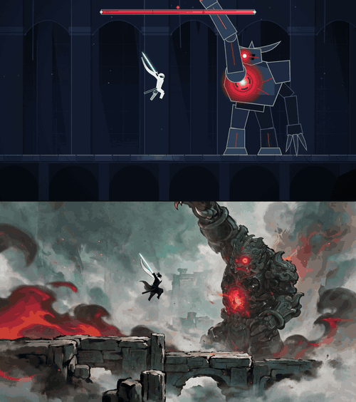
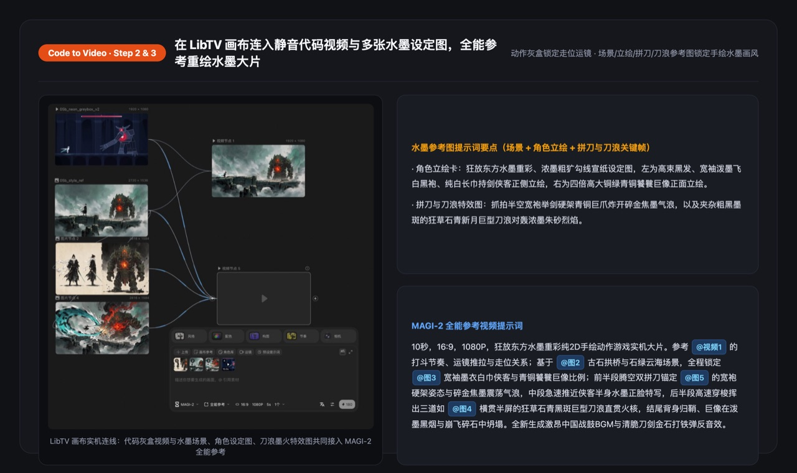

<div align="center">


# 歸藏 MAGI-2 Skill

**用 LibTV + MAGI-2 跑通 Video to Code 与 Code to Video 双向内容生产流程**

[English](README.en.md) · 简体中文

[](LICENSE)
[](https://www.liblib.tv)
[](references/libtv-mcp-antigravity.md)



*上屏是编程模型用代码生成的静音 2D 动作灰盒，下屏是通过 LibTV 全能参考由 MAGI-2 重绘出的水墨打斗成片。*

</div>

---

## 这是什么

一个给 AI 编程助手（Antigravity、Claude Code、Codex 等）用的实战 Skill。

视频模型单秒价格降到几分钱、理解力上来之后，它和编程 Agent 结合就不再局限于做短剧，而是能跑通两套互补的生产流：

- **Video to Code（视频转网页代码）**：先用几毛钱的视频把色彩、几何遮罩和连续转场动势定下来，再把同画风透明底产品图做成贴纸，交给编程模型写出单舞台一镜到底官网、实时倾倒流体和随滚动加速的电子乐。
- **Code to Video（代码转视频控制）**：反过来先让编程模型用代码写出静音动作灰盒，把跳跃、弹反顿帧、走位和镜头震屏调到分毫不差，再连同 3 到 4 张设定图喂给 LibTV 全能参考，一次性重绘成水墨或动画大片。

这个仓库不是空谈概念，里面装的是我跑通全部测试案例后留下的提示词规则、LibTV 在 Antigravity 上的 MCP 接入修复脚本，以及两套双向流程的可复用工具。

---

## 三块核心能力

### 1. MAGI-2 提示词优化与避坑规则
针对 MAGI-2 字面级物理渲染与默认润色压缩的特点，整理了 8 条硬规则和 4 套现成模板（详见 [`references/magi2-prompt-guide.md`](references/magi2-prompt-guide.md)）：
- **防润色吞细节**：10 秒控制在 350 到 550 字高密度物理描述，用时间戳与引号硬符号锁槽位
- **眼部光源绝对隔离**：避免眼睛、瞳孔与月光、反光同句出现导致人物眼球发光
- **三段式发力链防滑步**：拆解起势蓄力、跨步拧腰发力、惯性卸力，杜绝踩滑板平移和贴地机位切头
- **音画同句焊接与锐利中文锁字**：把碰撞拟音焊在动作句内，用英文双引号加实体表面锁死动态中文，消除文字果冻伪影

### 2. LibTV MCP 接入与 Antigravity 适配修复
官方默认配置主要面向 Codex 原生 HTTP MCP，直接在 Antigravity 等桌面客户端里跑容易遇到找不到 `npx`、60 秒超时断连或代理失效。仓库内置 [`scripts/setup_libtv_antigravity.py`](scripts/setup_libtv_antigravity.py) 一键修复，并写清了四个高频运行时坑位：
- `magi-2` 未开放首尾帧模式时统一走 `intent: "reference"` 全能参考
- 遇到 `wait_interrupted` 只轮询不重发，防止双倍扣费
- 本地灰盒上传遇到 `review_pending` 时的幂等重试方法

### 3. Video to Code 与 Code to Video 双向工作流

<table>
<tr>
<td width="50%" valign="top">

<br><br>
<b>玩法一：Video to Code</b>
<ul>
<li>六宫格分镜 + MAGI-2 生成连续转场原型视频</li>
<li><code>Seedream 5.5</code> 原生透明底 PNG + <code>make_diecut_stickers.py</code> 自动烘焙波普白边黑线贴纸与多物体切图</li>
<li>单舞台 <code>#masterStage</code> 无接缝滚动 + 二阶弹簧阻尼 + 60fps Canvas 倾倒流体 + 随滚动速度拉升 BPM 的 WebAudio 合成器</li>
</ul>
</td>
<td width="50%" valign="top">

<br><br>
<b>玩法二：Code to Video</b>
<ul>
<li>Canvas / Three.js 写出带顿帧与震屏的动作预演，去除持久几何辅助线</li>
<li><code>prep_code_previs.py</code> 强制物理剥离音轨（<code>-an</code>），防止廉价合成电音污染成片，并输出 12 宫格序列帧体检图</li>
<li>静音灰盒 + 3~4 张关键帧接力图送入 LibTV 全能参考重绘，一键导出上下分屏对比视频</li>
</ul>
</td>
</tr>
</table>

<p align="center">
  
</p>

---

## 安装

把这个仓库发给你的 AI 助手让它自动安装，或者手动克隆到对应工具的 `skills` 目录：

### Antigravity
```bash
git clone https://github.com/op7418/guizang-magi2-skill ~/.gemini/antigravity/skills/guizang-magi2-skill

# 一键安装并修复 Antigravity 上的 LibTV MCP 插件
python3 ~/.gemini/antigravity/skills/guizang-magi2-skill/scripts/setup_libtv_antigravity.py
```

### Claude Code
```bash
git clone https://github.com/op7418/guizang-magi2-skill ~/.claude/skills/guizang-magi2-skill
claude mcp add --transport http libtv https://mcp.liblib.tv/mcp
```

### Codex
```bash
git clone https://github.com/op7418/guizang-magi2-skill ~/.codex/skills/guizang-magi2-skill
codex mcp add libtv --url https://mcp.liblib.tv/mcp
```

装好后直接对 AI 说需求即可，例如：

```text
用 Video to Code 流程帮我做一个冷萃咖啡新品的一镜到底滚动官网：
先在 LibTV 生成六宫格和 10 秒波普转场参考视频，切好透明底贴纸，再写出带倾倒流体和滚动加速电子乐的网页。
```

或者：

```text
用 Code to Video 流程做一段 10 秒国风水墨横版 Boss 战短片：
先用代码生成带弹反顿帧的静音动作灰盒，确认节奏后配合设定图在 LibTV 里用 MAGI-2 全能参考重绘。
```

---

## 需要准备

| 工具 | 用途 | 备注 |
|---|---|---|
| [LibTV](https://www.liblib.tv) 账号 | 调用 `MAGI-2` 视频模型与 `Seedream 5.5` 透明底生图 | 首次调 MCP 工具时会自动在浏览器弹出授权登录 |
| Node.js 18+ | 运行 `npx mcp-remote` 桥接与本地预览服务 | Antigravity 接入必需 |
| Python 3.9+（推荐装 `uv`） | 运行 MCP 修复脚本、贴纸烘焙脚本与灰盒预处理脚本 | 仅贴纸脚本需 `pillow / numpy / scipy` |
| `ffmpeg` | Code to Video 剥离音轨、抽帧体检与合成上下对比视频 | `brew install ffmpeg` |

---

## 目录说明

| 路径 | 内容 |
|---|---|
| [`SKILL.md`](SKILL.md) | 主入口：核心判断、快速路由、提示词与 MCP 铁律、双向流程检查点 |
| [`references/magi2-prompt-guide.md`](references/magi2-prompt-guide.md) | MAGI-2 八条提示词实战铁律与 A–D 四套标准模板 |
| [`references/libtv-mcp-antigravity.md`](references/libtv-mcp-antigravity.md) | Antigravity 版 LibTV MCP 适配原理、安装参数与四大运行时报错解法 |
| [`references/workflows.md`](references/workflows.md) | Video to Code 与 Code to Video 完整工程拆解及核心代码骨架 |
| [`scripts/setup_libtv_antigravity.py`](scripts/setup_libtv_antigravity.py) | 零依赖一键配置/修复 Antigravity LibTV MCP 插件 |
| [`scripts/make_diecut_stickers.py`](scripts/make_diecut_stickers.py) | 基于欧氏距离场（EDF）的波普风白边黑线贴纸烘焙与多物体自动切图工具 |
| [`scripts/prep_code_previs.py`](scripts/prep_code_previs.py) | 代码灰盒物理静音（`-an`）、25fps 标准化、12 宫格体检图与上下分屏合成工具 |

---

## 许可

本仓库文档与脚本采用 [AGPL-3.0](LICENSE) 协议开源。

## 作者

[歸藏](https://x.com/op7418)。如果这个 Skill 帮你的 Agent 做出了好玩的网页或短片，欢迎点个 Star 交流。
